<picture>
  <source media="(prefers-color-scheme: dark)" srcset="header-dark.svg">
  <source media="(prefers-color-scheme: light)" srcset="header-light.svg">
  
</picture>
Product Data Lead at a multi-brand textiles group in Sydney. I work across the whole data path, from SAP master data and warehousing through to analytics and reporting. Full-stack side projects on nights and weekends.
 
**[LinkedIn](https://www.linkedin.com/in/parsa-taba-b60890193/)** &nbsp;·&nbsp; **[parsataba.xyz](https://parsataba.xyz)** &nbsp;·&nbsp; Open to connect
 
### Day job
 
- **Master data governance.** SAP product data across multiple brands and international sales organisations, with validation frameworks and automated quality checks.
- **Warehousing and reporting.** SQL, ETL pipelines and multi-layer transformations feeding BI, used by procurement, inventory and assortment planning.
- **Product lifecycle.** Launch data workflows, discontinuations and twice-yearly continuity reviews across thousands of SKUs.
- **Team and tooling.** Lead the product data entry team. Moved legacy workflows to version control, Python automation and web-based validation tools.
### Experience
 
- **Product Data Lead**, multi-brand textiles group, 2026 to now
- **Data Scientist**, same group, 2025 to 2026
- **Co-founder**, marketing and insights platform for venues and events, 2023 to 2026
- **Practice Performance**, health sector, 2024 to 2025
- **Business Development**, B2B software company in London, 2023 to 2024
Took part in an early-stage founder programme run by a venture capital firm in 2024.
 
### Building
 
Side projects in three areas. Most repos are private.
 
- Nightlife discovery
- Small business tooling
- Personal health
### Stack
 
| Area | Tools |
|:--|:--|
| **Languages** | Python, SQL, TypeScript, R, VBA |
| **Data** | SAP S/4HANA, ETL, warehousing, Power Query, Git |
| **Analytics** | Statistical modelling, regression, hypothesis testing, predictive models |
| **BI** | Power BI, Excel, KPI dashboards |
| **Web** | Next.js, React, Tailwind, Prisma |
 
### Education and certifications
 
- Master of Applied Data Science, Monash University
- Bachelor of Science (Human Biology), The Australian National University
- SAP Certified Data Engineer, SAP BW/4HANA (2026)
- SAP Certified, SAP Business Data Cloud (2026)
 
